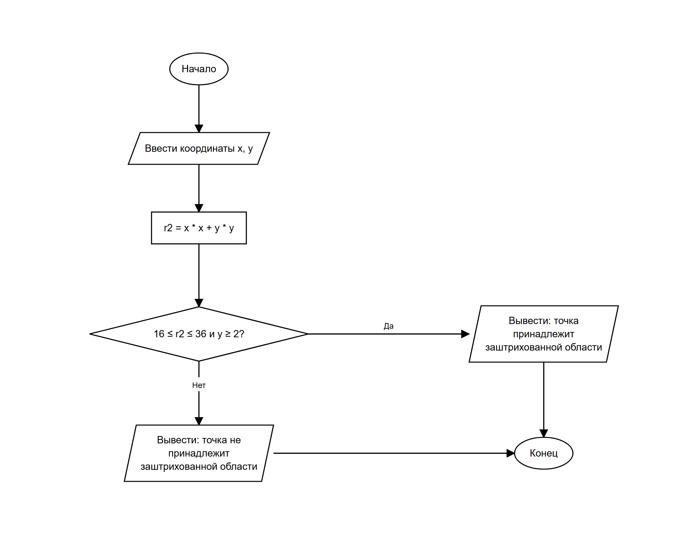

# Домашнее задание к работе 6

## Условие задачи
Составить программу, которая проверяет, принадлежит ли заданная пользователем точка с координатами (x, y) заданной заштрихованной области, и выводит на экран сообщение. Область (вариант 14) — часть кольца между окружностями x² + y² = 16 и x² + y² = 36, лежащая выше прямой y = 2.

## 1. Алгоритм и блок-схема

### Алгоритм
1. **Начало**
2. Ввести координаты точки **x** и **y**.
3. Вычислить квадрат расстояния от начала координат: **r2 = x * x + y * y**.
4. Проверить условие принадлежности заштрихованной области (все три условия должны выполняться одновременно):
   - точка лежит не ближе внутренней окружности: **r2 >= 16**;
   - точка лежит не дальше внешней окружности: **r2 <= 36**;
   - точка лежит не ниже прямой y = 2: **y >= 2**.
5. Если условие истинно, вывести сообщение «точка принадлежит заштрихованной области», иначе — «точка не принадлежит заштрихованной области».
6. **Конец**

### Блок-схема


## 2. Реализация программы

```c
#define _CRT_SECURE_NO_DEPRECATE

#include <stdio.h>
#include <stdlib.h>

int main() {
    double x, y;
    double r2;

    system("chcp 65001 > nul");

    puts("Введите координаты точки x и y");
    scanf("%lf %lf", &x, &y);

    r2 = x * x + y * y;

    // Контрольный пример:
    // (0; 5): x*x + y*y = 25, 16 <= 25 <= 36 и y = 5 >= 2 -> принадлежит
    // (0; 3): x*x + y*y = 9, 9 < 16 -> не принадлежит
    // (5; 1): x*x + y*y = 26, 16 <= 26 <= 36, но y = 1 < 2 -> не принадлежит
    // (0; 7): x*x + y*y = 49, 49 > 36 -> не принадлежит

    if (r2 >= 16 && r2 <= 36 && y >= 2)
        printf("Точка (%.2f; %.2f) принадлежит заштрихованной области\n", x, y);
    else
        printf("Точка (%.2f; %.2f) не принадлежит заштрихованной области\n", x, y);

    return 0;
}
```

## 3. Результаты работы программы

Запуск с точкой **(0; 5)**:

```
Введите координаты точки x и y
0 5
Точка (0.00; 5.00) принадлежит заштрихованной области
```

Запуск с точкой **(0; 3)**:

```
Введите координаты точки x и y
0 3
Точка (0.00; 3.00) не принадлежит заштрихованной области
```

Запуск с точкой **(5; 1)**:

```
Введите координаты точки x и y
5 1
Точка (5.00; 1.00) не принадлежит заштрихованной области
```

Запуск с точкой **(0; 7)**:

```
Введите координаты точки x и y
0 7
Точка (0.00; 7.00) не принадлежит заштрихованной области
```

## 4. Информация о разработчике
Сбоев Даниил, бОТИ-261
